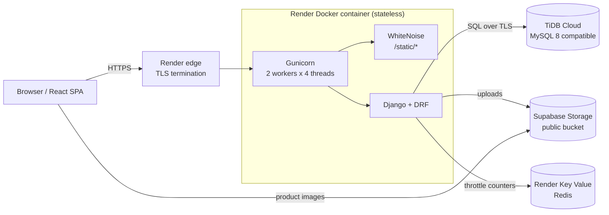

# VendorPulse

VendorPulse is a full-stack second-hand marketplace with its own delivery network. Buyers browse moderated listings, pay a per-item delivery fee, track each package, rate sellers and agents, open disputes, and request returns within 24 hours of delivery. Sellers list and manage items, delivery agents work an auto-assigned pickup/delivery queue, and admins moderate listings, run zones and hubs, manage staff, and resolve disputes and refunds.

It is a Django REST Framework API plus a React single-page app, backed by MySQL, with production packaging for a stateless container.

**Live demo:** https://vendorpulse-el66.onrender.com — free tier, so the first request after 15 minutes of inactivity takes about a minute while the container wakes.

---

## Table of contents

1. [Tech stack & architecture](#tech-stack--architecture)
2. [Key features](#key-features)
3. [Repository structure](#repository-structure)
4. [Environment variables](#environment-variables)
5. [Local development setup](#local-development-setup)
6. [Production deployment (Render Blueprint)](#production-deployment-render-blueprint)
7. [Operational notes](#operational-notes)
8. [Documentation](#documentation)

---

## Tech stack & architecture

| Layer | Local development | Production |
|---|---|---|
| Frontend | Vite dev server on `:5173` | React build served as static files |
| Backend | Django dev server on `:8000` | Gunicorn, 2 workers × 4 threads |
| Database | MySQL 8 on `:3306` | TiDB Cloud Starter (MySQL 8 compatible, TLS) |
| Cache | Django `LocMemCache` | Render Key Value (Redis) |
| Media | `Backend/media/` on disk | Supabase Storage (S3-compatible bucket) |
| Static files | Django dev server | WhiteNoise inside Gunicorn (no Nginx) |
| Hosting | — | Render Docker web service |
| Delivery | — | Render Blueprint + auto-deploy on push to `Main` |

### Request routing



| Request | Served by |
|---|---|
| `/static/*` | WhiteNoise (compressed CSS/JS/assets) |
| `/api/*` | Django + DRF |
| `/api/schema/`, `/api/docs/`, `/api/redoc/` | drf-spectacular (OpenAPI / Swagger / ReDoc) |
| `/django-admin/*` | Django admin |
| `/health/` | JSON health endpoint used by Render |
| everything else | SPA fallback → React `index.html` |

Production is a **single origin**: the SPA and the API share one hostname, so session cookies are first-party and CORS stays empty. In development, Vite proxies `/api` to Django and strips the prefix, which is why the backend keeps bare API mounts only while `DEBUG=True`.

---

## Key features

### Accounts and authentication

- Buyer registration and login, session-cookie auth with CSRF protection.
- Role-specific portals: buyer, delivery agent (`/agent/login/`), admin (`/admin/login/`).
- Profile with city, operating zone, phone, seller verification and agent flags.
- Brute-force and spam guards via DRF throttles: login `5/min`, registration `10/hour`.
- Separate Django admin at `/django-admin/` (the React admin portal owns `/admin/*`).

### Listings and moderation

- Sellers create and edit listings with image upload, description, price, city and zone.
- Categories: Clothing, Electronics, Furniture, Books, Vehicles, Other.
- Conditions: Brand New, Like New, Good, Fair.
- Every new or edited listing waits for moderation: `PENDING` → `APPROVED` / `REJECTED`, with a rejection reason.
- Marketplace feed filters by category, condition, city and free-text search, paginated 24 per page.
- Listing lifecycle is separate from moderation: `AVAILABLE` → `RESERVED` → `SOLD`.

### Cart and checkout

- One cart per buyer; add and remove items.
- Pincode-first checkout: the buyer's 6-digit pincode resolves the delivery zone and city.
- Price preview endpoint (`/api/products/checkout/quote/`) before placing the order.
- Delivery charge is calculated per item and snapshotted onto the order, so later rate changes never rewrite history.
- Each item ships and is tracked as its own package; the tracking number is `TRK-<order_id>`, shared by the items of one order, and delivery is confirmed with a 4-digit OTP.

### Orders and buyers

- Per-item status ladder:
  - Intra-city: `ORDER_PLACED` → `PICKUP_SCHEDULED` → `PICKED_UP` → `DISPATCHED` → `DELIVERED`
  - Intercity: adds `DROPPED_AT_ORIGIN_HUB` → `IN_TRANSIT` → `AT_DESTINATION_HUB` before `DELIVERED`
- Tracking by `TRK-<order_id>`.
- Buyers can cancel before pickup, with a reason shown to the seller.
- After delivery: open one dispute per item, or rate the seller and/or agent from 1 to 5 stars.
- Return requests are open for 24 hours after delivery (`RETURN_WINDOW_HOURS`).

### Returns and refunds

- Return reasons: changed mind, damaged, not as described, wrong item, other.
- One request per delivered item; admin approves or rejects with a note.
- Approval refunds item price + that item's delivery charge, reverses the 5% commission (seller payout becomes zero) and restocks the listing.

### Deliveries and logistics

- Automatic pickup assignment when an order item is created: verified agents in the item's city, preferring the item's zone, then least-loaded.
- Capacity cap: `MAX_ACTIVE_LOAD = 8` in-flight tasks per agent across both legs; when nobody has capacity, staff are notified for manual assignment.
- Intercity items use two legs: pickup agent → origin hub, then destination hub → buyer. The delivery agent is assigned in the buyer's city when the item arrives.
- Timed line-haul: dispatching stamps an ETA from the hub-route transit hours; arrivals are settled lazily by the order/delivery endpoints (`settle_linehaul_arrivals`), with no background worker required.
- Agent dashboard, status updates with OTP verification, profile and earnings.
- Admin tools: assign/reassign deliveries, advance fulfillment status, staff management, analytics, disputes and returns.

### Zones, hubs and notifications

- 12 supported cities: Mumbai, Delhi, Bengaluru, Hyderabad, Chennai, Kolkata, Pune, Ahmedabad, Jaipur, Lucknow, Indore, Chandigarh.
- Zones own numbered pincode ranges; hubs belong to a city and a zone; hub routes store transit hours.
- Seeder commands create zones, hubs, routes and agent accounts.
- In-app notifications with unread state, mark-one-read and mark-all-read.

### Money model

Rates live in `Backend/vendorpulse_core/settings.py` and are applied by `vendorpulse_core/pricing.py`; every amount is snapshotted per order item at checkout.

| Component | Amount | Paid by / to |
|---|---|---|
| Intra-city delivery | ₹39.00 | Buyer |
| Intercity delivery | ₹89.00 | Buyer |
| Platform commission | 5% of item price | Deducted from seller payout |
| Agent pay, intra-city | ₹25.00 | One agent, both legs |
| Agent pay, intercity pickup | ₹20.00 | Leg 1 agent |
| Agent pay, intercity delivery | ₹30.00 | Leg 2 agent |

### Abuse protection

| Throttle | Limit |
|---|---|
| Login / portal login | 5 per minute |
| Registration | 10 per hour |
| Delivery OTP attempts | 5 per minute |
| Checkout | 10 per minute |
| Listing creation | 2 per hour |
| Ratings | 20 per minute |
| Cancellations / disputes | 10 per minute each |

### API surface

All canonical endpoints live under `/api/`. The table lists groups, not every parameter.

| Area | Base path | Endpoints |
|---|---|---|
| Auth | `/api/accounts/` | `register/`, `login/`, `logout/`, `me/`, `profile/`, `portal-login/` |
| Marketplace | `/api/products/` | `items/`, `items/<id>/`, `my-listings/`, `cart/`, `cart/add/<item_id>/`, `cart/remove/<cart_item_id>/`, `checkout/quote/`, `checkout/`, `seller-dashboard/`, `admin/moderation/`, `admin/moderation/<item_id>/review/` |
| Orders | `/api/orders/` | `success/<order_id>/`, `track/<tracking_number>/`, `items/<order_item_id>/rate/`, `.../cancel/`, `.../dispute/`, `.../return/` |
| Deliveries | `/api/deliveries/` | `agent/deliveries/`, `agent/deliveries/<pk>/update/`, `agent/profile/`, `agent/earnings/`, `admin/deliveries/`, `admin/deliveries/<pk>/assign/`, `admin/deliveries/<pk>/status/`, `admin/orders/<pk>/update/`, `admin/staff/`, `admin/staff/<pk>/update/`, `admin/users/<user_id>/verify/`, `admin/analytics/`, `admin/disputes/`, `admin/disputes/<id>/resolve/`, `admin/returns/`, `admin/returns/<id>/resolve/` |
| Notifications | `/api/notifications/` | collection root, `read-all/`, `<pk>/read/` |
| Locations | `/api/locations/` | `zones/resolve/`, `zones/`, `admin/zones/`, `admin/zones/<pk>/`, `admin/hubs/`, `admin/hubs/<pk>/` |
| Docs | `/api/schema/`, `/api/docs/`, `/api/redoc/` | OpenAPI, Swagger UI, ReDoc |
| Health | `/health/` | `{"status": "ok"}` |

---

## Repository structure

```text
VendorPulse/
├── Backend/
│   ├── manage.py
│   ├── requirements.txt            # runtime dependencies (pinned)
│   ├── requirements-dev.txt        # local scenario tooling (not in the image)
│   ├── .env.example                # environment template
│   ├── certs/
│   │   └── isrgrootx1.pem          # CA used by DB_SSL_MODE=VERIFY_IDENTITY
│   ├── vendorpulse_core/
│   │   ├── settings.py             # env-driven settings, production hardening
│   │   ├── urls.py                 # canonical /api mounts + SPA fallback
│   │   ├── pricing.py              # delivery fees, commission, agent pay
│   │   ├── throttles.py            # DRF throttle classes
│   │   ├── pagination.py           # shared page/page_size/all pagination
│   │   ├── api_docs.py             # drf-spectacular metadata
│   │   └── wsgi.py, asgi.py
│   ├── accounts/                   # Profile, registration, login, portals
│   ├── products/                   # Item, Cart, CartItem, moderation
│   ├── orders/                     # Order, OrderItem, Rating, Dispute, ReturnRequest
│   ├── deliveries/                 # agent/admin delivery APIs, linehaul.py
│   ├── notifications/              # in-app notifications
│   ├── locations/                  # Zone, DeliveryHub, HubRoute + seed commands
│   ├── media/                      # local uploads (git-ignored)
│   ├── staticfiles/                # collectstatic output (git-ignored)
│   └── spa/                        # Vite build copied here in the image (git-ignored)
├── frontend/
│   ├── package.json
│   ├── vite.config.js              # dev proxy; production base=/static/
│   ├── index.html
│   └── src/
│       ├── api.js                  # fetch wrapper: cookies + CSRF header
│       ├── App.jsx, main.jsx
│       ├── features/
│       │   ├── auth/               # Login, Register, PortalLogin
│       │   ├── marketplace/        # Home, Products, listing, cart, checkout, tracking
│       │   ├── seller/             # Post/Edit listing, seller dashboard
│       │   ├── profile/            # profile, orders, sales
│       │   ├── agent/              # agent dashboard
│       │   └── admin/              # admin portal + tabs (orders, returns, ...)
│       ├── components/             # navbar, modals, pagination, notifications
│       └── context/                # AuthContext
├── deploy/
│   ├── entrypoint.sh               # container start: migrate → collectstatic → gunicorn
│   ├── provision.sh, release.sh    # optional VPS/self-host track
│   ├── preflight.sh
│   ├── nginx-vendorpulse.conf
│   ├── vendorpulse.service, vendorpulse-backup.cron
│   ├── backup.cnf.example
│   └── README.md                   # VPS track notes
├── Docs/
│   ├── DEPLOYMENT.md               # full deployment runbooks (Render + VPS)
│   ├── DEPLOYMENT_PLAN.md, .pdf
│   └── VendorPulse_SRS.pdf
├── Dockerfile                      # 3-stage build: SPA → wheels → runtime
├── render.yaml                     # Blueprint: web service + Key Value
├── .dockerignore
└── .gitignore
```

`Backend/hub_scenario.py`, `linehaul_scenario.py` and `zones_scenario.py` are manual end-to-end checks; each runs inside a transaction that is rolled back.

---

## Environment variables

The backend reads configuration from the process environment and, locally, from `Backend/.env` (git-ignored). Commit only `.env.example`. Never put real credentials in `render.yaml` or documentation.

| Variable | Required | Example | Notes |
|---|---|---|---|
| `SECRET_KEY` | Prod: yes | `replace-with-a-long-random-secret` | Settings refuse to start when `DEBUG=False` and this is missing. Render generates it. |
| `DEBUG` | No (default `False`) | `True` | Use `True` locally only. Production must be `False`. |
| `ALLOWED_HOSTS` | No on Render | `vendorpulse.example.com` | Comma-separated. `RENDER_EXTERNAL_HOSTNAME` is added automatically. |
| `CSRF_TRUSTED_ORIGINS` | No | `https://vendorpulse.example.com` | Dev defaults to the Vite origins; the Render origin is added automatically. |
| `CORS_ALLOWED_ORIGINS` | No | `https://app.example.com` | Only for a cross-origin frontend. Production is same-origin. |
| `DB_NAME` | Yes | `vendorpulse` | |
| `DB_USER` | Yes | `vp` / `<prefix>.root` | |
| `DB_PASSWORD` | Yes | `replace-with-a-strong-password` | Secret. |
| `DB_HOST` | Yes | `127.0.0.1` | |
| `DB_PORT` | Yes | `3306` / `4000` | TiDB Cloud uses `4000`. |
| `DB_SSL_MODE` | Managed DB: yes | `VERIFY_IDENTITY` | `REQUIRED` encrypts without verifying the hostname. |
| `DB_SSL_CA` | With `VERIFY_IDENTITY` | `/app/Backend/certs/isrgrootx1.pem` | TiDB's chain is anchored at the bundled ISRG root. |
| `REDIS_URL` | Recommended in prod | `redis://<host>:6379` | Shared cache so throttle counters work across workers. |
| `SUPABASE_BUCKET` | Prod media: yes | `vendorpulse-media` | Without it, uploads go to local disk. |
| `SUPABASE_ENDPOINT_URL` | With bucket | `https://<project-ref>.supabase.co/storage/v1/s3` | S3-compatible endpoint. |
| `SUPABASE_ACCESS_KEY_ID` | With bucket | `replace-with-s3-access-key` | Secret. |
| `SUPABASE_SECRET_ACCESS_KEY` | With bucket | `replace-with-s3-secret-key` | Secret. |
| `SUPABASE_REGION` | No | `us-east-1` | Default. |
| `SUPABASE_PUBLIC_HOST` | With bucket | `<project-ref>.supabase.co/storage/v1/object/public/vendorpulse-media` | Public URL prefix; the bucket must be public. |
| `MEDIA_ROOT` | No | `/path/to/shared/media` | Local-disk fallback only. |
| `SERVE_BARE_API` | No | `False` | Defaults to `True` when `DEBUG=True`, otherwise `False`. |
| `WEB_WORKERS` | No | `2` | Gunicorn worker processes. |
| `WEB_THREADS` | No | `4` | Gunicorn threads per worker. |
| `SEED_ON_START` | No | `1` | First boot on an empty database only. |
| `DB_DEBUG` | No | `1` | Prints DB target, password length and a SHA-256 prefix (never the password) at startup. Remove after use. |
| `RENDER_EXTERNAL_HOSTNAME` | Injected | `vendorpulse.onrender.com` | Set by Render; do not configure manually. |
| `PORT` | Injected | `10000` | Set by Render; Gunicorn binds to it. |

---

## Local development setup

### Prerequisites

- Python **3.12**
- Node.js **22** with npm
- MySQL **8.0+** (MariaDB works, but use `utf8mb4_unicode_ci` instead of `utf8mb4_0900_ai_ci`)
- Git

`mysqlclient` compiles against MySQL/MariaDB client libraries. On Debian/Ubuntu install `python3-dev default-libmysqlclient-dev pkg-config build-essential`; on Windows, the published wheel usually installs without a compiler.

### 1. Clone the repository

```bash
git clone https://github.com/uzi612/VendorPulse.git
cd VendorPulse
```

### 2. Create the backend virtual environment

```bash
cd Backend
python -m venv venv
```

Activate it:

```powershell
# Windows (PowerShell)
.\venv\Scripts\Activate.ps1
```

```bash
# macOS / Linux
source venv/bin/activate
```

Then install dependencies:

```bash
pip install -r requirements.txt
```

### 3. Create the database

```sql
CREATE DATABASE vendorpulse
  CHARACTER SET utf8mb4
  COLLATE utf8mb4_0900_ai_ci;
```

### 4. Configure `Backend/.env`

```bash
cp .env.example .env        # Windows: copy .env.example .env
```

Generate a secret key:

```bash
python -c "import secrets; print(secrets.token_urlsafe(50))"
```

Minimal local configuration:

```dotenv
SECRET_KEY=replace-with-the-generated-value
DEBUG=True

DB_NAME=vendorpulse
DB_USER=vp
DB_PASSWORD=your-local-password
DB_HOST=127.0.0.1
DB_PORT=3306
```

Notes:

- Leave `SUPABASE_*` empty to store uploads in `Backend/media/`.
- Leave `DB_SSL_MODE` empty for a local MySQL server.
- Leave `REDIS_URL` empty to use the in-process cache.
- `ALLOWED_HOSTS` can stay empty in development; Django allows `localhost` / `127.0.0.1`.
- `CSRF_TRUSTED_ORIGINS` defaults to the Vite origins when `DEBUG=True`.

### 5. Migrate and seed

```bash
python manage.py migrate

# Optional demo data (idempotent)
python manage.py seed_zones          # numbered zones with pincode ranges
python manage.py seed_hubs           # one Central Hub per city
python manage.py seed_hub_routes     # transit hours for every hub pair
python manage.py seed_zone_agents    # ~8-12 delivery agents per zone

python manage.py createsuperuser     # Django admin account
```

Seeded agents use the username `"First Last"` and the password set by `seed_zone_agents.py` (the lowercase first name). Review that command before using it on any shared or public environment.

### 6. Run the backend

```bash
python manage.py runserver 8000
```

### 7. Run the frontend

In a second terminal, from the repository root:

```bash
cd frontend
npm install
npm run dev
```

Open **http://localhost:5173**.

The Vite dev server proxies `/api` to `http://127.0.0.1:8000` and strips the `/api` prefix, so development uses the backend's bare mounts. That is why `SERVE_BARE_API` defaults to `True` when `DEBUG=True` and to `False` otherwise.

### 8. Sign in

| Portal | URL | Account |
|---|---|---|
| Storefront | `/accounts/login/`, `/accounts/register/` | Buyer account |
| Agent | `/agent/login/` | Seeded delivery agent in the `DeliveryAgent` group |
| Admin | `/admin/login/` | Staff or superuser |
| Django admin | `/django-admin/` | Superuser |

### 9. Tests and checks

From `Backend/`:

```bash
python manage.py test                 # accounts, products, orders, deliveries
```

Manual end-to-end scenarios (they need a migrated, seeded database and roll back their own writes):

```bash
python zones_scenario.py
python hub_scenario.py
python linehaul_scenario.py
```

`requirements-dev.txt` adds the local tooling used by the verification scripts.

---

## Production deployment (Render Blueprint)

The deployed stack is a Render Docker web service plus a Render Key Value instance, both declared in `render.yaml`. Database and media live outside Render.

### 1. Prepare the database (TiDB Cloud Starter or any MySQL 8 host)

1. Create the instance and note host, port (`4000` for TiDB Cloud), user and password.
2. Create the schema:

   ```sql
   CREATE DATABASE vendorpulse
     CHARACTER SET utf8mb4
     COLLATE utf8mb4_0900_ai_ci;
   ```

3. Import your dump. The schema must exist first; the dump contains no `CREATE DATABASE` or `USE`.
4. Keep TLS on. TiDB Cloud certificates chain to the ISRG root that is already committed at `Backend/certs/isrgrootx1.pem`, so `DB_SSL_MODE=VERIFY_IDENTITY` and `DB_SSL_CA=/app/Backend/certs/isrgrootx1.pem` work without uploading a certificate.

### 2. Prepare object storage (Supabase Storage)

1. Create a **public** bucket, for example `vendorpulse-media`.
2. Create an S3 access key pair from the project's storage settings.
3. Note:
   - endpoint: `https://<project-ref>.supabase.co/storage/v1/s3`
   - region: `us-east-1`
   - public prefix: `https://<project-ref>.supabase.co/storage/v1/object/public/<bucket>`
4. Upload existing media. Database rows store relative paths such as `items/p9.jpg`, so no rows need changing.

   ```bash
   aws s3 cp --recursive Backend/media s3://vendorpulse-media \
     --endpoint-url https://<project-ref>.supabase.co/storage/v1/s3 \
     --region us-east-1
   ```

### 3. Create the Blueprint

1. Render Dashboard → **New** → **Blueprint**.
2. Select the repository (`uzi612/VendorPulse`) and branch (`Main`).
3. Render reads `render.yaml` and proposes two resources:
   - `vendorpulse` — Docker web service, free plan, Singapore, health check `/health/`, auto-deploy on push
   - `vendorpulse-redis` — free Key Value instance; `REDIS_URL` is wired from it automatically
4. Provide the five values marked `sync: false`:

   | Variable | Value |
   |---|---|
   | `DB_HOST` | TiDB host, e.g. `gateway01.<region>.prod.aws.tidbcloud.com` |
   | `DB_USER` | TiDB user, e.g. `<cluster-prefix>.root` |
   | `DB_PASSWORD` | TiDB password |
   | `SUPABASE_ACCESS_KEY_ID` | Supabase S3 key id |
   | `SUPABASE_SECRET_ACCESS_KEY` | Supabase S3 secret |

`SECRET_KEY` is generated by Render. `DEBUG=False`, `DB_NAME`, `DB_PORT`, `DB_SSL_MODE`, `DB_SSL_CA`, all `SUPABASE_*` bucket settings, `WEB_WORKERS` and `WEB_THREADS` come from the Blueprint.

> Create the service through **Blueprint**, not **New → Web Service**. A dashboard-created web service does not read `render.yaml`, which leaves it without environment variables and the app fails at startup.

### 4. Startup sequence

`deploy/entrypoint.sh` runs on every boot:

```text
==> migrate            # applies pending migrations
==> collectstatic      # copies SPA + admin assets into STATIC_ROOT
==> gunicorn on 0.0.0.0:10000
```

Expected log lines:

```text
No migrations to apply.
159 static files copied to '/app/Backend/staticfiles', ...
Listening at: http://0.0.0.0:10000
```

- On a **fresh empty database**, set `SEED_ON_START=1` for the first deploy so zones, hubs, routes and agents are created, then remove it.
- On a **database that was imported from an existing environment**, leave `SEED_ON_START` unset.
- Render injects `PORT` and `RENDER_EXTERNAL_HOSTNAME`; `ALLOWED_HOSTS` and `CSRF_TRUSTED_ORIGINS` are extended automatically, so no host configuration is needed.

### 5. Verify the deployment

```bash
curl -s https://<service>.onrender.com/health/
curl -s -o /dev/null -w "%{http_code}\n" https://<service>.onrender.com/
curl -s -o /dev/null -w "%{http_code}\n" https://<service>.onrender.com/api/schema/
curl -s https://<service>.onrender.com/api/products/items/ | head -c 300
```

Expected: `{"status": "ok"}`, `200`, `200`, and a JSON page of items.

### 6. Optional: run the production image locally

From the repository root:

```bash
docker build -t vendorpulse .
docker run --rm -p 10000:10000 --env-file Backend/.env vendorpulse
```

The container listens on `http://localhost:10000`. With `DEBUG=True` in `.env` it uses development settings; set `DEBUG=False`, `SECRET_KEY` and `ALLOWED_HOSTS` to reproduce production behaviour (HTTPS-only cookies and the SSL redirect then require an `X-Forwarded-Proto: https` header).

### CI/CD

Render builds on every push to the connected branch (`autoDeploy: true`). There is no separate CI workflow committed in this repository.

`[TODO: add a GitHub Actions workflow if tests should gate deploys.]`

The `deploy/` directory also contains a self-hosted VPS track (Nginx, systemd, release scripts, backup cron). It is independent of the Render Blueprint; see `Docs/DEPLOYMENT.md`.

---

## Operational notes

### The container is disposable

Nothing important is written to the container filesystem:

- relational data lives in TiDB,
- uploads live in Supabase Storage,
- throttle counters live in Redis.

A redeploy, restart or crash therefore cannot lose application data. Logs and the collected static files are the only local artefacts.

### Cold starts and the free tier

- Render free web services sleep after **15 minutes** without traffic and wake on the next request in about a minute. The first request can briefly return a 502 while the container starts.
- While asleep, `/robots.txt` is answered by Render with `Disallow: /`.
- `/health/` is exempt from the HTTPS redirect so the platform probe works.
- The free plan grants **750 instance hours per month** per workspace; sleeping services do not consume them.

### Persistence and pausing

| Service | Behaviour |
|---|---|
| TiDB Cloud Starter | Data persists independently of Render. Free quota: 5 GiB + 50M request units per month. |
| Supabase Storage | Free projects pause after roughly **7 days without database activity**. Resume the project in the Supabase dashboard; images return `404` until then. Data is retained. |
| Render Key Value | In-memory only on the free plan. Data is lost when the instance restarts; only throttle counters are stored. |

### Security posture

- `DEBUG=False` enables HTTPS redirect, secure session/CSRF cookies, HSTS with preload, `X-Content-Type-Options: nosniff` and `X-Frame-Options: DENY`.
- Secrets are read from the environment only. `Backend/.env`, database dumps and uploaded media are git-ignored.
- Login, registration, OTP verification, checkout, ratings, cancellations, disputes and listing creation are throttled.
- The delivery OTP is 4 digits and is rate-limited to 5 attempts per minute.
- `/api/docs/` and the Supabase bucket are public in this demo. Restrict them if the deployment stops being a demo.
- Rotate `DB_PASSWORD`, Supabase keys and `SECRET_KEY` immediately if any of them are exposed in chat, logs or a screenshot.

### Backups

Backups are not automated by the application. Take a logical dump before imports or destructive admin work:

```bash
mysqldump --single-transaction --no-tablespaces \
  --host=<host> --port=<port> --user=<user> --password \
  --ssl-mode=VERIFY_IDENTITY --ssl-ca=Backend/certs/isrgrootx1.pem \
  vendorpulse | gzip > backups/vendorpulse-$(date +%F-%H%M).sql.gz
```

The `backups/` directory is git-ignored because dumps contain password hashes and customer data.

`[TODO: schedule automated dumps if this deployment leaves demo status.]`

---

## Documentation

| Document | Contents |
|---|---|
| `Docs/DEPLOYMENT.md` | Full deployment runbook: Render track, VPS track, TLS, imports, smoke checklist |
| `Docs/DEPLOYMENT_PLAN.md` | Deployment plan and decision log |
| `Docs/VendorPulse_SRS.pdf` | Software requirements specification |
| `deploy/README.md` | Self-hosted VPS notes |
| `/api/docs/` | Live Swagger UI (also `/api/redoc/` and `/api/schema/`) |

`[TODO: add a LICENSE file and a short CONTRIBUTING guide.]`
